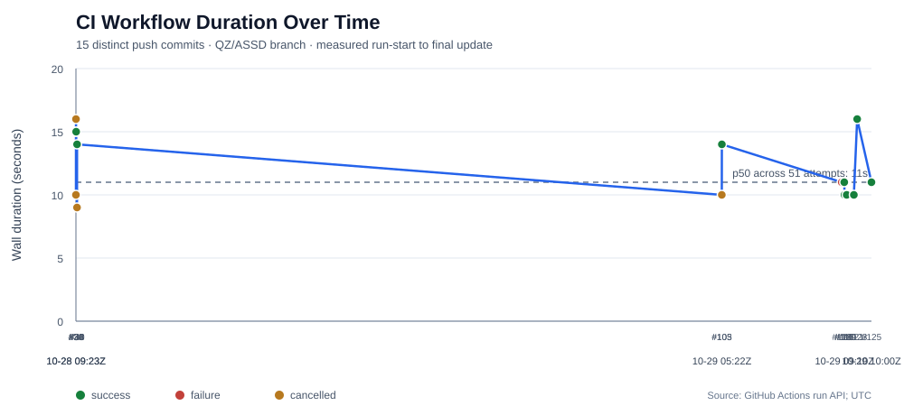
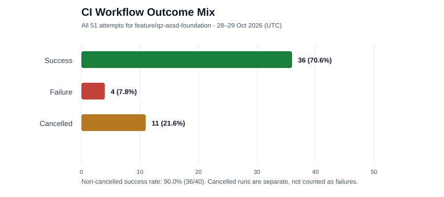

# QZ / ASSD Performance & Progress-over-Time Report

**Report ID:** QZ-PERF-2026-10-29-01  
**As of:** 2026-10-29 (UTC)  
**Status:** Evidence-backed CI telemetry snapshot; product/agent production telemetry remains NOT CONNECTED.  
**Repository subproject:** [QZ Intelligence subprojects](https://github.com/sdsdsd7007-uxx/Chat-gptX/tree/feature/qz-intelligence-subprojects-v1/docs/qz-intelligence)  
**CI scope:** `feature/qz-assd-foundation`, GitHub Actions workflow `Project QZ ASSD Validation`, workflow ID `399203979`.

## Executive result

- **51 workflow attempts** observed between 2026-10-28T09:08:55Z and 2026-10-29T10:00:25Z.
- **36 success, 4 failure, 11 cancelled.** Success among completed non-cancelled attempts is **90.0% (36/40)**. Cancelled is tracked separately and is not counted as a failure.
- Observed run-start-to-final-update latency: **p50 11s; p90 15s; maximum 17s**. Durations are rounded to whole seconds and describe GitHub Actions workflow runs, not production inference, research, tool calls, end-to-end agent work, or business operations.
- Latest exact-head run on the PR #4 branch: [push run #125](https://github.com/sdsdsd7007-uxx/Chat-gptX/actions/runs/40854041493) succeeded in about 11 seconds; the matching [pull-request run #126](https://github.com/sdsdsd7007-uxx/Chat-gptX/actions/runs/40854049426) succeeded in about 9 seconds.
- Production remains **HOLD**. Passing CI does not satisfy independent review, trusted authorization, staging acceptance, recovery/rollback proof or release approval.

## Graph 1 — performance over time

This graph uses the 15 most recent **distinct push commit SHAs** from the 51-attempt branch history, sorted by start time. It deliberately includes failures and cancellations as separate markers. The horizontal position represents actual UTC time; the y-axis is run duration in seconds. This is a pipeline timing trend, not an engine-performance claim.

## Graph 2 — progress/outcome mix

All 51 attempts are represented. The 11 cancellations may be due to concurrency policy or superseded commits, but their causes were not individually verified in this summary; inspect the run logs before attributing them. The success rate above excludes cancellations from its denominator.

## Data definitions and limitations

1. **Duration:** rounded `updated_at − run_started_at` seconds for each API-returned workflow run. Queue time before `run_started_at` is excluded. Results come from the GitHub Actions REST API; raw rows and run URLs are in [CI_RUN_HISTORY_2026-10-29.csv](CI_RUN_HISTORY_2026-10-29.csv).
2. **Sample:** 51 returned attempts for one branch, including both `push` and `pull_request` triggers. Attempts can share the same commit SHA; they are not 51 independent code changes.
3. **No fabricated values:** no production request-latency, cost-per-outcome, end-user satisfaction, Market X live feed or agent-authority-test result is imputed from CI timing. Unknown remains UNKNOWN/NOT CONNECTED.
4. **Test case counts differ by code scope** and should not be interpreted as a comparable efficiency league table: current known green runs include PR #1 42 tests, PR #2 85 tests, PR #4 39 tests on each of Ubuntu 24.04 and 26.04, PR #5 22 tests, and PR #7 56 tests. These are commit/run-specific; exact-head CI is not established for docs-only PR #8 and PR #9. Proposed Agent Authority Tests AA-001–AA-014 remain **PROPOSED — NOT RUN**.

## Workflow dependency inventory (read-only snapshot)

The following pull-request refs were inspected at their current known heads on 2026-10-29:

| PR/ref | Workflow observed | Dependency references | Assessment |
|---|---|---|---|
| [PR #1](https://github.com/sdsdsd7007-uxx/Chat-gptX/pull/1) / `project-q/controlled-foundation` | `.github/workflows/project-q-checks.yml` | `actions/checkout@<full SHA>`, `actions/setup-python@<full SHA>` | Step actions pinned to full commit SHAs; Dependabot configured weekly. |
| [PR #2](https://github.com/sdsdsd7007-uxx/Chat-gptX/pull/2) / `project-q/security-hardening-q-sec-02` | `.github/workflows/project-q-checks.yml` | `actions/checkout@<full SHA>`, `actions/setup-python@<full SHA>` | Step actions pinned to full commit SHAs; Dependabot configured weekly for GitHub Actions and pip. |
| [PR #4](https://github.com/sdsdsd7007-uxx/Chat-gptX/pull/4) / `feature/qz-assd-foundation` | `.github/workflows/qz-validation.yml` | `actions/checkout@v7`, `actions/setup-node@v7` | Tag references; recommend reviewed full-SHA pins or verified lockfile adoption. |
| [PR #5](https://github.com/sdsdsd7007-uxx/Chat-gptX/pull/5) and [PR #7](https://github.com/sdsdsd7007-uxx/Chat-gptX/pull/7) | `.github/workflows/qz-validation.yml` | `actions/checkout@v7`, `actions/setup-node@v7` | Tag references; same hardening action. |
| [PR #8](https://github.com/sdsdsd7007-uxx/Chat-gptX/pull/8) and [PR #9](https://github.com/sdsdsd7007-uxx/Chat-gptX/pull/9) | No `.github/workflows` found in inspected trees | None in these documentation branches | No exact-head CI runs returned for the inspected current heads; this is not evidence of passing tests. |

No remote reusable-workflow call of the form `jobs.<job_id>.uses` was found in the inspected workflow files. Therefore the upstream `gh-actions-lock` issue #179 gap is **not a confirmed current exposure for these inspected files**. Re-run this inventory when workflow files change. The known gap remains relevant if a future workflow invokes remote reusable workflows.

Official GitHub documentation says workflow dependency lockfiles pin actions and their transitive action dependencies, but do not pin remote reusable-workflow calls; those require full commit-SHA references in YAML. GitHub announced lockfiles GA on 2026-10-28, and the lockfile still does not establish that a dependency is safe. Pilot in a non-production branch and verify generated coverage before enforcing.

## Best-practice research translated into controls

### 1. CI software supply chain

- PR #1/#2's workflow pins `actions/checkout` and `actions/setup-python` to full commit SHAs, while PR #4/#5/#7 currently use `@v7` tags for checkout/setup-node. Standardize the QZ workflow to reviewed full-SHA pins with a human-readable version comment, or pilot GitHub's workflow dependency lockfile in an isolated branch and verify every direct/transitive dependency.
- GitHub announced workflow dependency lockfiles GA on 2026-10-28. The lockfile protects the exact code that runs but does not establish that dependencies are benign. The documented coverage gap for remote reusable workflows remains relevant if `jobs.<job_id>.uses` is introduced; pin those calls directly to a reviewed full SHA and independently review their dependency chain.
- Continue using least privilege (`contents: read` is appropriate for the visible validation workflow), explicit timeouts, bounded test commands and cancellation behavior. Review `cancel-in-progress: true` policy for each workflow so only superseded runs are cancelled.

### 2. Agent and authorization architecture

- Keep the separation: **intelligence proposes → deterministic policy evaluates → authenticated/authorized gate permits → bounded executor acts → independent evidence verifies**. A caller-supplied approval flag or model assertion is not a trusted identity or authorization service.
- Require distinct agent identities, attenuated delegation, least privilege, short-lived/revocable credentials, human approval for high-impact actions, signed mandates where appropriate, append-only audit evidence, and fail-closed handling of unknown identity, expired approvals, replay and changed action payloads.
- Keep performance tuning subordinate to correctness, evidence provenance, safe authorization and recovery. The requested 100-microsecond objective is applicable only to selected local operations under a pinned hardware/runtime/workload—not a full research or model-driven task.

### 3. KPI and graph discipline

- For true engine/user performance curves, instrument timestamped records with metric definition, unit, sample count, source identity, freshness, commit/config version and error state. Report p50/p95/p99 for latency and separate queue, network, inference and local compute.
- Chart actuals separately from target/forecast. Never zero-fill missing observations. Require at least two valid observations for a trend, expose denominators and uncertainty, and preserve reproducible source rows.
- Add a baseline and target only after an owner defines the workload and acceptance test. No production KPI baseline is claimed by this report.

## Prioritized next actions

| Priority | Action | Evidence to close | State |
|---|---|---|---|
| P0 | Keep production hold; complete independent security/release review | Authenticated authorization proof, reviewers, exact-head CI, documented approval | OPEN |
| P0 | Pin `actions/checkout` / `actions/setup-node` in QZ workflow or validate lockfile pilot | Full-SHA refs or reviewed lockfile with all inputs covered; follow-up CI pass | OPEN |
| P1 | Investigate 4 failures and 11 cancellations individually | Each run classified as code defect, flaky test, infrastructure, or superseded/cancelled | OPEN — reasons not fully classified |
| P1 | Execute AA-001–AA-014 in controlled test environment | Timestamped result, build SHA, environment, log, independent reviewer for each | NOT RUN |
| P1 | Add end-to-end telemetry and reproducible performance benchmark | At least two valid timestamped observations; p50/p95/p99 and quality alongside latency | NOT CONNECTED |
| P1 | Verify staging recovery/rollback | Authorized staging evidence and restore/retest proof | NOT EVIDENCED |
| P2 | Expand factor/country intelligence modules one at a time | Named owner, source register, acceptance suite, value/use case and support plan | PROPOSED |

## Conclusion

The observed QZ/ASSD validation pipeline is fast at the run level (p50 11s, p90 15s), and the latest PR #4 exact-head push/pull-request runs passed. The next optimization is not blindly reducing seconds: classify failed/cancelled attempts, harden action pinning and introduce genuine timestamped application telemetry. Keep speed, evidence quality, security and recovery as a joint acceptance gate.

## Sources

- [GitHub Actions runs for Project QZ](https://github.com/sdsdsd7007-uxx/Chat-gptX/actions?query=branch%3Afeature%2Fqz-assd-foundation)
- [PR #4 workflow source](https://github.com/sdsdsd7007-uxx/Chat-gptX/blob/feature/qz-assd-foundation/.github/workflows/qz-validation.yml)
- [PR #1 controlled workflow](https://github.com/sdsdsd7007-uxx/Chat-gptX/blob/project-q/controlled-foundation/.github/workflows/project-q-checks.yml)
- [GitHub's workflow dependency lockfile announcement (28 Oct 2026)](https://github.blog/changelog/2026-10-28-github-actions-workflow-lockfiles-are-generally-available/)
- [GitHub docs: workflow dependency lockfiles](https://docs.github.com/en/enterprise-cloud@latest/actions/concepts/security/workflow-dependency-lockfiles)
- [Upstream issue #179 — remote reusable workflow coverage gap](https://github.com/github/gh-actions-lock/issues/179)
- [NIST: Design Tenets for Agent Identity Management Systems (27 Oct 2026)](https://www.nist.gov/blogs/cybersecurity-insights/design-tenets-agent-identity-management-systems)
- [Australian Signals Directorate: Agentic AI harnesses (11 Sep 2026)](https://www.cyber.gov.au/advisory/agentic-ai-harnesses)
